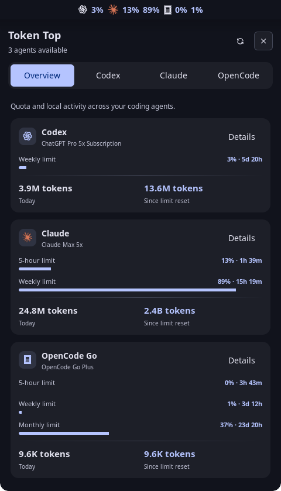

# Token Top

Track Codex, Claude Code, and OpenCode Go usage from your Noctalia bar.

## Get started

Requires **Noctalia 5.4+** and **ripgrep**. OpenCode Go also needs **sqlite3**.

1. Sign in with `codex login`, `claude login`, or `opencode auth`.
2. Add `https://github.com/spinualexandru/token-top-noctalia` as a source in **Noctalia → Plugins**.
3. Enable **Token Top**, add its widget to your bar, and choose your providers in plugin settings.

Click the widget to see quota usage, reset times, and local session activity.
